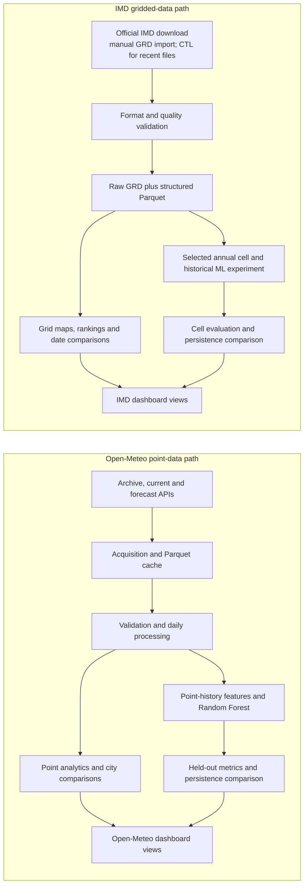

<h1 align="center">Climate Intelligence</h1>

<p align="center">
  <strong>Heatwave Analytics &amp; Temperature Forecasting</strong><br>
  An exploratory Python dashboard for Indian temperature data: official IMD grids, Open-Meteo estimates, interactive analysis, and experimental Random Forest models.
</p>

<p align="center"><em>Explore the data. Understand its limits.</em></p>

<p align="center">
  <a href="https://www.python.org/"></a>
  <a href="https://streamlit.io/"></a>
  <a href="https://plotly.com/python/"></a>
  <a href="https://pandas.pydata.org/"></a>
  <a href="https://numpy.org/"></a>
  <a href="https://scikit-learn.org/"></a>
  <a href="./LICENSE"></a>
  <a href="https://github.com/yojit2016/climate-intelligence"></a>
  <a href="https://github.com/yojit2016/climate-intelligence/issues"></a>
  <a href="https://github.com/yojit2016/climate-intelligence/commits/main"></a>
</p>

## Overview

Climate Intelligence is an academic analytics prototype for exploring daily
maximum temperatures across six Indian cities and official IMD gridded datasets.
It combines Open-Meteo historical reanalysis and current model estimates with a
separate manual workflow for importing and validating IMD GRD files. Interactive
charts, geographic maps, coverage-aware summaries, and experimental machine
learning help make the data easier to inspect without presenting it as an
official warning service.

The two data workspaces remain separate: IMD grid data is never blended with
Open-Meteo point estimates. Missing values remain missing; the app does not
invent substitute weather data.

## Features

- **Open-Meteo acquisition:** current conditions and a separate provider
  forecast, plus historical daily data for Mumbai, Delhi, Pune, Ahmedabad, Jaipur,
  and Nagpur. Historical data comes from the archive endpoint; it is not bridged
  with forecast values.
- **IMD GRD import and validation:** manual import of annual 1° Tmax grids and
  recent daily 0.5° grids with a matching CTL file. Binary size, declared
  dimensions, dates, byte order, missing values, and broad value ranges are
  checked before data is stored.
- **Cleaning and processing:** timezone-aware dates, duplicate handling,
  invalid-value checks, explicit missing calendar dates, and processing
  summaries. Optional gap-aware Savitzky–Golay smoothing is descriptive only
  and is not used by the ML models.
- **Temperature analytics:** daily trends and extremes, threshold exceedances,
  monthly and seasonal summaries, and city comparisons with coverage counts.
- **Geographic analysis:** IMD temperature heatmaps, hottest grid-cell rankings,
  nearest available grid-cell lookup, two-date comparisons, and B-minus-A
  difference maps restricted to cells valid on both dates.
- **Experimental machine learning:** three independent Random Forest models for
  1-, 2-, and 3-day-ahead daily maximum temperature, with historical evaluation
  and a persistence baseline.
- **Evaluation:** chronological train/validation/test partitions, validation
  model selection, and per-horizon MAE/RMSE comparisons.
- **Exports:** CSV downloads for point-data tables and IMD maps, comparisons,
  cell series, and summaries. IMD imports also retain a separate raw GRD and a
  structured Parquet representation.
- **Four-section Streamlit dashboard:** Overview, Historical Analysis, ML
  Forecasting, and Data Processing in both workspaces.

## Dashboard preview

No application screenshots are included yet. The preview section will be
updated with genuine captures from the running dashboard; no mock screenshots
are used. See [instructions for adding screenshots](docs/screenshots/README.md).

Suggested captures: Open-Meteo overview, IMD geographic heatmap and date
comparison, ML evaluation, and the data-processing summary.

## Architecture

IMD and Open-Meteo have distinct acquisition and processing paths. The diagram
shows their separate outputs; it does not imply automatic data fusion.



## Tech stack

| Technology | Role |
| --- | --- |
| Python 3.11+ | Application and data-processing runtime |
| Streamlit | Interactive dashboard and app tests |
| Pandas, NumPy | Tabular processing, statistics, and GRD decoding |
| Plotly | Interactive time-series charts and geographic heatmaps |
| scikit-learn | Random Forest regression and evaluation metrics |
| SciPy | Optional gap-aware Savitzky–Golay smoothing |
| Requests | Open-Meteo HTTP client |
| PyArrow | Parquet storage and data interchange |
| pytest | Offline unit and dashboard integration tests |

Dependency ranges are maintained in [`requirements.txt`](requirements.txt);
Python metadata and pytest configuration are in [`pyproject.toml`](pyproject.toml).

## Installation

Python 3.11 or newer is required. Run from the repository root.

### Windows PowerShell

```powershell
python -m venv .venv
.\.venv\Scripts\python -m pip install -r requirements.txt
.\.venv\Scripts\python -m streamlit run app.py
```

Open [http://localhost:8501](http://localhost:8501). Stop the foreground
server with **Ctrl+C**. Activating the environment is optional.

### macOS / Linux

```bash
python3 -m venv .venv
.venv/bin/python -m pip install -r requirements.txt
.venv/bin/python -m streamlit run app.py
```

The Open-Meteo workspace needs internet access for uncached data. The free API
is for noncommercial use; check the provider's current terms before commercial
use. IMD downloads are obtained manually from the official site and imported
locally.

## Usage

1. Start the app and choose **Open-Meteo point estimates** or
   **IMD gridded temperature** under **Data workspace**.
2. In Open-Meteo, choose a city, date range, and optional analysis controls, then
   select **Apply filters**. The first load acquires three calendar years for
   all six cities; chart filters do not shorten the model's training history.
3. Use the four dashboard sections to review the overview, historical charts or
   maps, forecasts or historical model experiments, and processing information.
4. To import IMD data, open **Data Processing**, select the annual or recent
   product, declare its date and byte order, upload the GRD (and matching CTL
   for recent daily files), confirm the format, and validate the import.
5. In IMD **Historical Analysis**, select a product date to see the heatmap and
   hottest locations. Enable **Compare two IMD dates** to compare compatible
   dates from the same imported grid.
6. In **ML Forecasting**, compare estimates with persistence and inspect the
   held-out MAE/RMSE metrics. Open-Meteo forecasts from the provider are shown
   separately from the local Random Forest outputs.
7. Use the available download controls for CSV tables and IMD statistics. The
   imported IMD raw GRD and structured Parquet are stored separately; Data
   Processing includes the complete structured dataset download.

See the [dashboard guide](docs/DASHBOARD_GUIDE.md) for a detailed walkthrough
and chart interpretation, and [IMD import documentation](docs/IMD.md) for
supported formats, validation rules, and scientific limitations.

## Machine learning

The application trains three direct `RandomForestRegressor` models for horizons
of one, two, and three days. Features include the latest daily maximum, lags of
1, 2, 3, and 7 days, trailing 7- and 14-day means, and the target date's month
and cyclical day of year. Gaps are not imputed, and the latest 14 days must be
complete for inference.

Evaluation uses chronological 70/15/15 train, validation, and test blocks.
Labels crossing partition boundaries are removed; validation MAE selects
between a maximum depth of six and unrestricted trees. The selected model is
scored on held-out test data, then refit separately on all available samples for
inference. MAE and RMSE are compared per horizon with **persistence**, which
repeats the most recent observed maximum.

Open-Meteo model inputs use that city's historical archive, independently of
chart filters. When history is current, predictions follow the latest completed
day. If history is stale, the UI labels predictions as historical rather than
upcoming. IMD ML is an optional historical endpoint experiment on one selected
annual grid cell; it is not an Open-Meteo forecast or a live city prediction.
The provider's four-day Open-Meteo forecast is a separate product and is not an
input or output of the local model.

## Processing and cache behavior

Point-data raw API tables and quality-controlled tables are stored separately as
Parquet under `data/raw/` and `data/processed/`. Calendar gaps remain explicit,
and no temperature imputation is performed. Sanity bounds are broad data-quality
checks, not heatwave thresholds. Centered Savitzky–Golay smoothing uses adjacent
valid values for descriptive charts only; it is never used for ML.

Historical request caches expire after six hours; current conditions and
provider forecasts expire after 15 minutes. Model results are held in a bounded
in-memory cache for six hours. **Refresh weather data** bypasses acquisition
caches and clears model results. Streamlit refresh timers run only while the
dashboard is open; they are not scheduled background services. Expired history
is not silently served as fresh data following network failure.

Compatible point-weather sources follow the `WeatherSource` contract in
[`climate/sources.py`](climate/sources.py). The IMD grid importer is intentionally
a separate workflow rather than a point-provider adapter.

## Data sources and attribution

- **India Meteorological Department (IMD):** imported official station-derived,
  spatially gridded maximum-temperature products. Annual historical 1° files
  and recent daily 0.5° files are separate products. Imports are manual; an
  official live download integration has not been verified. See the official
  [historical annual Tmax page](https://imdpune.gov.in/cmpg/Griddata/Max_1_Bin.html)
  and [recent daily Tmax page](https://www.imdpune.gov.in/cmpg/Realtimedata/max/Max_Download.html).
  Follow IMD's source terms and retain its requested citation and disclaimers
  when sharing derived data. The historical product cites Srivastava, A. K.,
  Rajeevan, M., and Kshirsagar, S. R. (2009), *Development of High Resolution
  Daily Gridded Temperature Data Set (1969–2005) for the Indian Region*,
  [doi:10.1002/asl.232](https://doi.org/10.1002/asl.232). See
  [IMD documentation](docs/IMD.md) for more detail.
- **Open-Meteo:** current and forecast model estimates, and historical
  reanalysis/model estimates from its
  [Historical Weather API](https://open-meteo.com/en/docs/historical-weather-api).
  Current and forecast data use the
  [Forecast API](https://open-meteo.com/en/docs). These are not direct station
  observations. Attribute Open-Meteo and its data under
  [CC BY 4.0](https://creativecommons.org/licenses/by/4.0/); the free API is
  subject to the provider's [terms of use](https://open-meteo.com/en/terms).

The [MIT License](LICENSE) applies to original project code only. It does not
relicense meteorological datasets, API responses, or other third-party content.

The supplied actual 2025 IMD GRD has been validated locally; its detailed
measurements and verification scope are documented in the
[2025 validation record](docs/IMD_2025_VALIDATION.md). Raw and processed
datasets are excluded from Git and must be obtained or generated separately.

## Project structure

```text
.
├── app.py                    Streamlit entry point
├── climate/                  Acquisition, processing, analytics, IMD, ML, and UI
├── docs/
│   ├── DASHBOARD_GUIDE.md    Dashboard interpretation guide
│   ├── IMD.md                IMD import and format guide
│   ├── IMD_2025_VALIDATION.md
│   └── screenshots/          Screenshot capture instructions
├── tests/                    Offline tests and dashboard integration tests
├── .streamlit/config.toml    Streamlit defaults
├── pyproject.toml            Project metadata and pytest configuration
├── requirements.txt          Runtime and test dependencies
├── LICENSE                   MIT license for original project code
└── README.md
```

Generated datasets, caches, virtual environments, secrets, and model artifacts
are not part of the tracked project tree.

## Testing and diagnostics

Run the offline test suite and check the installed dependency constraints from
PowerShell:

```powershell
.\.venv\Scripts\python -m pytest -q
.\.venv\Scripts\python -m pip check
```

To make a live-data diagnostic request for one city:

```powershell
.\.venv\Scripts\python -m climate.check --city Delhi --years 3 --refresh
```

To check all supported cities, including live requests and training:

```powershell
.\.venv\Scripts\python -m climate.check --all-cities --refresh
```

The diagnostic uses the network and may fail when the API is unavailable; such
failures are reported and are not represented as successful live verification.
The regular tests are designed to run offline. The
[`tests/test_imd_actual.py`](tests/test_imd_actual.py) tests use the actual
official 2025 GRD only when that file exists at
`data/raw/imd/Maxtemp_MaxT_2025.GRD` or `data/Maxtemp_MaxT_2025.GRD`. If it is
absent, pytest explicitly skips those checks; it does not substitute synthetic
weather data.

## Limitations

- This is an academic analytics prototype, not an official IMD heatwave-warning
  or alert service. Exploratory thresholds are not official IMD criteria.
- IMD GRD data is a manually imported static product, not a live data stream.
- Open-Meteo current and historical values are modeled/reanalysis estimates,
  not direct observations at the selected city.
- Random Forest results are experimental, have no calibrated uncertainty
  interval, and are not guaranteed to outperform persistence.
- IMD model targets are interpolated grid-cell values, not independent station
  measurements.
- The project does not implement operational alert dissemination, an AWS
  deployment/network integration, or a publicly hosted service.
- Summary statistics and partial-period seasonal results require care; changing
  missing-data coverage can affect comparisons.

## Future improvements

Potential future work, not currently implemented, includes:

- A verified IMD authenticated download workflow, subject to official access
  requirements.
- Multi-year climatological analysis and additional data-quality comparisons.
- Forecast models incorporating additional meteorological variables and
  improved out-of-sample monitoring.
- Validated, region-specific heatwave classification using official criteria.
- Optional integration of locally operated IoT weather stations.
- Deployment, alert-delivery design, and operational monitoring after
  appropriate validation.

## Contributing

Bug reports and focused improvement proposals are welcome through
[GitHub Issues](https://github.com/yojit2016/climate-intelligence/issues).
For a change, describe the motivation and scope, keep claims and tests grounded
in actual behavior, and open a pull request with relevant test results. Do not
include credentials or redistribute meteorological data without confirming its
source terms.

## License

Original project code is licensed under the [MIT License](LICENSE).
Third-party datasets, API content, and other upstream materials remain subject
to their respective terms and attribution requirements.
